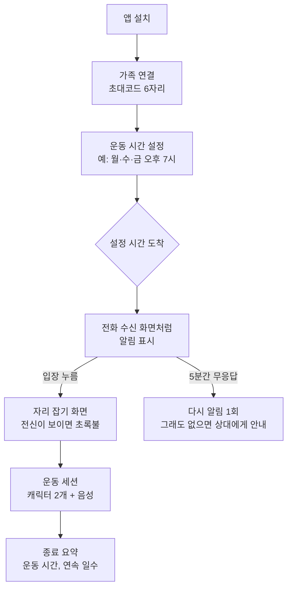
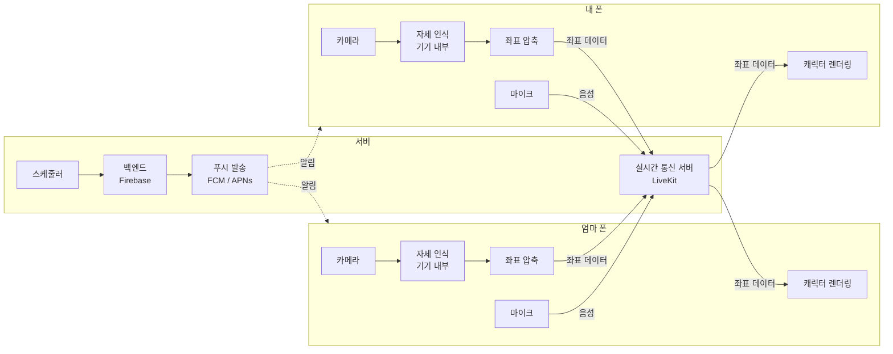

# 위드무브 WithMove 설계 문서

> 엄마와 내가 정해진 시간에 만나 함께 운동하는 앱.
> 목소리는 그대로 들리고, 모습은 **캐릭터**로만 보인다.

- 상태: 초안 v0.2
- 최종 수정: 2026-11-19

### 확정된 사항
| 항목 | 결정 |
|---|---|
| 운동 종류 | **서서 하는 운동** (스쿼트, 제자리 걷기, 팔 돌리기, 옆구리 스트레칭, 런지 등) |
| 캐릭터 | **사람형 캐릭터** |
| 엄마 기기 | **삼성 갤럭시 탭 S9 FE+ (SM-X610)**: Android 태블릿, 12.4인치, Exynos 1380 |
| 앱 이름 | **위드무브 (WithMove)** |

---

## 1. 목표와 범위

### 목표
1. 정해진 시간이 되면 두 사람이 쉽게 "운동 통화"에 들어온다.
2. 서로의 **동작**은 캐릭터로 실시간 전달되고, **목소리**는 그대로 들린다.
3. 카메라 원본 영상은 **절대 기기 밖으로 나가지 않는다.**
4. 엄마(고령 사용자)가 혼자서도 쓸 수 있을 만큼 단순하다.

### 이번 범위에서 하지 않는 것
- 2명 초과 그룹 운동
- 운동 영상 녹화나 저장
- 정교한 자세 교정 코칭 (나중 단계에서 검토)

---

## 2. 설계 원칙

| 원칙 | 구체적 규칙 |
|---|---|
| 영상은 기기 밖으로 나가지 않는다 | 카메라 프레임은 메모리에서 자세 인식에만 쓰고 바로 버린다. 서버로는 관절 좌표만 보낸다. |
| 마이크는 동의 후에만 켠다 | 통화는 자동 연결하지 않는다. 사용자가 "입장" 버튼을 눌러야 마이크가 켜진다. |
| 체형도 감춘다 | 받는 쪽에서 좌표를 그대로 그리지 않고 **관절 각도만** 캐릭터에 입힌다. 키나 체형 같은 신체 비율이 노출되지 않는다. |
| 엄마 기준 UX | 큰 글씨, 큰 버튼, 한 화면에 할 일 하나. 설정은 내 폰에서 대신 할 수 있게 한다. |

---

## 3. 사용자 흐름



### 화면 목록 (MVP)
1. **온보딩**: 이름 입력, 캐릭터 고르기, 카메라와 마이크 권한 요청
2. **가족 연결**: 초대코드 생성 / 입력
3. **홈**: 다음 운동 시간, 연속 운동 일수, 큰 "지금 운동하기" 버튼
4. **일정 설정**: 요일과 시간 (상대방 일정도 함께 바꾸는 기능은 내 폰 전용)
5. **수신 화면**: "엄마가 기다리고 있어요" + [입장] / [10분 뒤에]
6. **자리 잡기**: 내 캐릭터 미리보기, 전신 인식 여부 표시, 거치 안내
7. **운동 세션**: 상대 캐릭터를 크게, 내 캐릭터는 작게, 음소거와 종료 버튼
8. **종료 요약**

---

## 4. 시스템 구조



### 기술 선택

| 영역 | 선택 | 이유 |
|---|---|---|
| 앱 | **Flutter** | iOS와 Android를 하나의 코드로 지원. 엄마와 내가 다른 OS여도 문제없음 |
| 자세 인식 | **Google ML Kit Pose Detection** (`google_mlkit_pose_detection`) | 기기 내부에서 동작, iOS/Android 모두 지원, 관절 33개 |
| 실시간 통신 | **LiveKit** (Cloud로 시작, 필요하면 자체 서버로 이전) | 음성 트랙과 데이터 채널을 한 연결로 처리, Flutter SDK 제공, 종단간 암호화 지원 |
| 인증과 DB | **Firebase Auth + Firestore** | 2인용 소규모 앱에 충분하고 무료 구간 안에서 운영 가능 |
| 스케줄과 토큰 발급 | **Cloud Functions** | 정기 실행, LiveKit 접속 토큰 발급 |
| 푸시 | **FCM** (Android), **APNs VoIP + CallKit** (iOS) | 전화 오는 것처럼 화면을 띄우기 위함 (`flutter_callkit_incoming`) |
| 캐릭터 | 1단계: Flutter `CustomPainter`로 그린 2D 사람형 캐릭터 → 2단계: 3D 사람형(VRM) | 처음엔 빠르게 검증하고, 반응이 좋으면 고도화 |

---

## 5. 핵심 모듈 설계

### 5.1 자세 인식 (보내는 쪽)

```
카메라 (720p, 전면 또는 후면)
  → ML Kit Pose (stream 모드), 목표 15fps
  → 관절 33개 (x, y, z, 신뢰도)
  → 떨림 보정 (One Euro Filter)
  → 압축해서 전송
```

- 프레임 처리가 밀리면 이전 프레임은 버리고 최신 프레임만 처리한다 (지연 누적 방지).
- 신뢰도가 낮은 관절은 "보이지 않음"으로 표시해서 보낸다.
- 폰이 뜨거워지면 10fps로 자동으로 낮춘다.
- **갤럭시 탭(엄마):** 화면을 보면서 운동해야 하므로 **전면 카메라 + 가로 모드**를 기본으로 한다. 태블릿 전면 카메라는 화각이 넓은 편이라 전신을 담기 유리하다.

### 5.2 좌표 전송 형식

데이터 채널은 **손실 허용(unreliable, unordered)** 모드를 쓴다. 늦게 도착한 동작은 필요 없기 때문이다.

```
PosePacket (바이너리, 약 140바이트)
┌────────────┬──────────┬───────────────────────────────┐
│ version u8 │ seq u16  │ timestamp_ms u32              │
├────────────┴──────────┴───────────────────────────────┤
│ 관절 33개 × (x i16, y i16, z i16, 신뢰도 u8) ... 또는  │
│ 관절 각도 방식: 주요 관절 14개 × (각도 i16 × 2)       │
└───────────────────────────────────────────────────────┘
```

- **권장: 관절 각도 방식.** 보내는 쪽에서 좌표를 각도로 바꿔서 보낸다. 체형 정보가 아예 기기 밖으로 나가지 않고 데이터도 더 작다.
- 15fps × 약 100바이트 ≈ **초당 1.5KB**. 영상 통화(초당 약 150KB 이상)의 1% 수준이다.

### 5.3 사람형 캐릭터 설계

- **뼈대:** 머리, 목, 몸통, 골반, 위팔·아래팔·손(좌우), 허벅지·종아리·발(좌우)로 총 15개 부위
- **표준 체형:** 모든 사용자가 같은 비율의 몸을 쓴다. 실제 키나 체형과 상관없이 동작만 보인다.
- **꾸미기:** 머리 모양, 머리색, 상의와 하의 색상, 피부톤을 고른다. 서로를 알아볼 수 있게 이름표를 머리 위에 표시한다.
- **얼굴:** 1단계에서는 기본 미소 표정. 4단계에서 표정 전달을 검토한다.
- **서서 하는 운동에 맞춘 단순화:** 바닥에 눕는 자세는 지원하지 않는다. 그래서 위아래 방향을 고정해도 되고 인식 실패도 줄어든다.

### 5.4 캐릭터 렌더링 (받는 쪽)

```
패킷 수신 → 지터 버퍼 (약 100ms) → 프레임 사이 보간 → 캐릭터 뼈대에 각도 적용 → 60fps로 그리기
```

- 패킷이 1초 이상 안 오면 캐릭터를 "잠깐 쉬는 중" 자세로 바꾼다.
- 전신이 인식되지 않으면 상대 화면에 "자리를 잡고 있어요"라고 표시한다.
- 음성과 동작의 시간차가 200ms를 넘지 않도록 지터 버퍼 크기를 조절한다.

### 5.5 일정과 알림

1. Cloud Function이 **1분마다** 실행된다.
2. 지금 시각에 해당하는 일정을 찾는다 (사용자 시간대 기준).
3. 세션 문서를 만들고 두 사람에게 푸시를 보낸다.
   - iOS: VoIP 푸시 → CallKit 수신 화면
   - Android: 전체 화면 알림 (full-screen intent)
4. 사용자가 [입장]을 누르면 앱이 서버에서 LiveKit 토큰을 받아 방에 들어간다.
5. 5분 동안 응답이 없으면 한 번 더 알리고, 그래도 없으면 먼저 들어온 사람에게 "엄마가 아직 준비 중이에요"라고 안내한다.

> **주의:** iOS는 VoIP 푸시를 받으면 반드시 CallKit 화면을 띄워야 한다. 그렇지 않으면 앱의 푸시가 차단된다. 이 규칙을 지키도록 구현해야 한다.

---

## 6. 데이터 모델 (Firestore)

```
users/{uid}
  name: "엄마"
  avatarId: "bear_01"
  timezone: "Asia/Seoul"
  pairId: "pair_abc"
  pushTokens: { fcm, apnsVoip }

pairs/{pairId}
  members: [uidMe, uidMom]
  inviteCode: "482913"        # 연결이 끝나면 삭제
  streakDays: 12

pairs/{pairId}/schedules/{scheduleId}
  days: [1, 3, 5]             # 월, 수, 금
  time: "19:00"
  durationMin: 20
  enabled: true

pairs/{pairId}/sessions/{sessionId}
  scheduledAt, startedAt, endedAt
  joined: { uidMe: ts, uidMom: ts }
  roomName: "pair_abc_20261119_1900"
  # 동작 데이터와 음성은 저장하지 않는다
```

**보안 규칙:** `pairs` 문서는 `members`에 포함된 사용자만 읽고 쓸 수 있다.

---

## 7. 프라이버시와 보안

| 항목 | 방침 |
|---|---|
| 카메라 영상 | 기기 메모리에서만 처리한다. 저장하거나 전송하지 않는다. |
| 동작 데이터 | 실시간 전달만 하고 서버에 저장하지 않는다. |
| 음성 | LiveKit 종단간 암호화(E2EE)를 켠다. 녹음 기능은 없다. |
| 마이크 | 사용자가 입장을 누른 후에만 켜진다. 음소거 버튼은 항상 화면에 크게 보인다. |
| 연결 | 초대코드는 6자리이고 10분 뒤 만료된다. 한 쌍에는 2명만 연결할 수 있다. |
| 카메라 사용 표시 | 세션 중 화면 위쪽에 "영상은 이 폰 밖으로 나가지 않아요"를 상시 표시해서 안심시킨다. |

---

## 8. 예외 상황

| 상황 | 처리 |
|---|---|
| 한 명만 입장 | 대기 화면을 보여주고, 5분 뒤 다시 알림. 혼자 운동하기도 선택 가능 |
| 네트워크 끊김 | 음성과 캐릭터가 멈추고 "다시 연결 중" 표시. 30초 동안 자동 재접속 시도 |
| 전신이 안 잡힘 | 자리 잡기 안내 표시 ("한 걸음 뒤로 가주세요") |
| 어두운 방 | 인식 신뢰도가 계속 낮으면 "불을 켜주세요" 안내 |
| 폰 과열 / 배터리 부족 | 처리 속도를 낮추고, 20% 이하이면 충전 권장 |
| 일정 시간에 이미 다른 통화 중 | CallKit이 처리하도록 두고, 나중에 앱을 열면 바로 입장할 수 있게 함 |

---

## 9. 엄마를 위한 UX 규칙

- 기본 글자 크기 20pt 이상, 버튼 높이 64pt 이상
- 한 화면에는 주요 버튼 1개만 둔다
- 아이콘만 쓰지 않고 항상 글자를 함께 쓴다 ("🔇 소리 끄기")
- 처음 설정(연결, 일정)은 **내 폰에서 원격으로** 할 수 있게 한다
- 폰 거치 방법을 그림으로 안내한다 (바닥에서 약 1m 높이, 2~3m 거리)

### 갤럭시 탭 전용 화면 배치 (가로 모드)
```
┌──────────────────────────────────────────────┐
│ 🔒 영상은 이 기기 밖으로 나가지 않아요        │
│                                ┌──────────┐ │
│        [ 상대(나) 캐릭터 크게 ]  │ 엄마     │ │
│                                │ 캐릭터   │ │
│                                └──────────┘ │
│   스쿼트  8 / 15회                 12:34 남음 │
│  [ 🔇 소리 끄기 ]          [ ⏹ 운동 끝내기 ] │
└──────────────────────────────────────────────┘
```
- 2~3m 떨어진 곳에서도 보이도록 횟수와 남은 시간은 아주 크게 표시한다.
- 태블릿 거치대 사용을 권장한다 (높이 약 1m, 가로로 세움).

---

## 10. 프로젝트 폴더 구조 (예정)

```
bulkyeo/
├── app/                      # Flutter 앱
│   └── lib/
│       ├── main.dart
│       ├── features/
│       │   ├── onboarding/
│       │   ├── pairing/
│       │   ├── schedule/
│       │   ├── incoming_call/
│       │   └── session/
│       ├── pose/             # 카메라 → 자세 인식 → 각도 변환
│       ├── transport/        # LiveKit 연결, 패킷 인코딩/디코딩
│       ├── avatar/           # 캐릭터 뼈대와 렌더링
│       └── common/           # 테마(큰 글씨), 공용 위젯
├── functions/                # Firebase Cloud Functions (TypeScript)
│   └── src/
│       ├── scheduler.ts      # 1분마다 일정 확인과 푸시 발송
│       ├── token.ts          # LiveKit 접속 토큰 발급
│       └── pairing.ts        # 초대코드 처리
└── docs/
    └── DESIGN.md
```

---

## 11. 개발 단계

| 단계 | 내용 | 완료 기준 |
|---|---|---|
| **0-a. 웹 실험** (진행 중) | 녹화한 영상으로 동작 → 사람형 캐릭터 변환 확인 (`prototype/pose-web/`) | 아이패드에서 캐릭터가 동작을 따라 함 |
| **0. 기술 검증** | 엄마의 갤럭시 탭 한 대에서 카메라 → 자세 인식 → 사람형 캐릭터가 따라 움직이기 | 갤럭시 탭에서 15fps 이상, 서서 하는 운동 5종 인식 성공 |
| **1. 둘이 연결** | LiveKit으로 음성 + 좌표 전송, 상대 캐릭터 보기 (수동 입장) | 서로 다른 와이파이에서 20분 동안 끊김 없이 동작 |
| **2. MVP** | 가족 연결, 일정, 수신 화면, 종료 요약 | 엄마가 도움 없이 일주일 동안 사용 |
| **3. 재미 요소** | 횟수 세기, 동작 맞추기 점수, 연속 일수 보상, 캐릭터 꾸미기 | |
| **4. 고도화** | 3D 캐릭터, 얼굴 표정 전달, 운동 프로그램 | |

**0단계가 가장 중요하다.** 자세 인식의 품질과 속도가 앱 전체의 체감을 좌우하기 때문에, 실제 엄마 폰과 실제 운동 공간에서 먼저 확인해야 한다.

---

## 12. 결정이 필요한 것

- [x] 주로 할 운동 → 서서 하는 운동
- [x] 캐릭터 스타일 → 사람형
- [x] 엄마 기기 → 갤럭시 탭
- [x] 갤럭시 탭 모델명 → S9 FE+ (SM-X610)
- [ ] 내 기기 기종 (iPhone이면 CallKit 구현이 필요)
- [ ] 비용: LiveKit Cloud와 Firebase 모두 2인 사용량이면 무료 구간 안에 들 것으로 예상하지만, 실제 사용량으로 확인 필요
- [x] 앱 이름 → 위드무브 (WithMove)

---

## 13. 앱 이름 후보 (위드무브로 결정)

| 이름 | 뜻 | 느낌 |
|---|---|---|
| **위드무브 WithMove** ⭐ | 함께(With) 움직이다(Move) | `with_exercise`와 가장 가깝고 짧고 기억하기 쉬움 |
| 같이핏 GachiFit | "같이" + 피트니스 | 한국어 감성이 살아 있고 친근함 |
| 마주운동 Maju | 서로 마주 보고 하는 운동 | 영상통화 콘셉트가 잘 드러남 |
| 투게더핏 TogetherFit | 함께하는 운동 | 뜻이 가장 직관적 |
| 엄마랑 MomAnd | "엄마랑 운동해요" | 따뜻하지만 대상이 엄마로 한정됨 |
